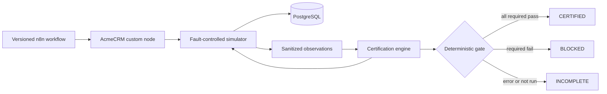

# ConnectorOps

> A release gate that proves an n8n connector is safe when the partner API is
> not.

Happy-path demos do not answer the enterprise question: what happens when a
write succeeds remotely but its response never arrives? ConnectorOps turns
that boundary failure into a repeatable certification test with an auditable
`CERTIFIED`, `BLOCKED`, or `INCOMPLETE` decision.

The reference integration is a custom AcmeCRM n8n node. Its simulator commits
an order and delays the response beyond the client timeout. The safe connector
retries with the same idempotency key and produces one order. The unsafe test
client retries without a key, produces two orders, and is blocked.

```text
                         first response is lost
 n8n workflow ──create──▶ AcmeCRM simulator ──commit──▶ order
      │                         ▲
      └──same key, retry────────┘

 observed: 2 requests · 1 order · CERTIFIED
 control:  2 requests · 2 orders · BLOCKED
```

The negative control proves that the test runner detects duplicate orders. A
passing report alone would not prove that.

## What is implemented

- A pinned Node.js 24/npm 11 workspace and n8n `2.44.5` deployment topology
- A TypeScript AcmeCRM simulator with memory and PostgreSQL stores
- Atomic idempotency replay and sanitized, hashed request evidence
- Deterministic `timeout-after-commit` and `rate-limit-then-success` faults
- A real custom n8n node with stable keys, bounded retry, `Retry-After`
  handling, nested-error normalization, and secret-safe errors
- A version-controlled n8n workflow exercised through n8n's real runtime
- A certification engine with explicit `PASS`, `FAIL`, `ERROR`, and `NOT_RUN`
  assertions; required failures cannot be averaged away
- Generated safe and negative-control evidence, CI, architecture decisions,
  deployment guidance, and a friction log

The implemented scope covers two failure scenarios. Authentication refresh,
pagination, webhooks, async jobs, and contract drift remain on the roadmap.

## Proven journeys

| Scenario                  | Required behavior                     | Evidence                                          | Decision    |
| ------------------------- | ------------------------------------- | ------------------------------------------------- | ----------- |
| Timeout after commit      | Retry with one stable key; one order  | `created → replayed`, two requests, one order     | `CERTIFIED` |
| Unsafe timeout control    | Detect duplicate partner effects      | two requests, two orders                          | `BLOCKED`   |
| Rate limit                | Honor `Retry-After: 0`; reuse one key | `rate_limited → created`, two requests, one order | `CERTIFIED` |
| Unsafe rate-limit control | Reject missing stable-key evidence    | two null key hashes                               | `BLOCKED`   |

See the generated [certified scorecard](docs/examples/certified-scorecard.json),
[blocked scorecard](docs/examples/blocked-scorecard.json), and
[partner-facing failure report](docs/examples/partner-failure-report.md).

## Architecture



n8n makes the connector invocation visible. TypeScript owns partner-protocol
correctness and the deterministic policy. The current workflow is intentionally
small (`Manual Trigger → AcmeCRM Safe Retry`); scenario setup and evidence
verification run in the execution script. Moving the full journey onto the
canvas is the next planned increment.

The decisions behind those boundaries are in [docs/decisions](docs/decisions),
and the ownership and delivery model is in the
[engineering delivery plan](docs/engineering-delivery-plan.md).

## Run it

Prerequisites: Node.js 24, npm 11, and Docker with Compose.

```bash
node --version # must report v24.x
npm --version  # must report v11.x
docker compose version
npm ci
npm run dev
```

Leave that terminal open. In a second terminal, verify that n8n, PostgreSQL,
and the AcmeCRM simulator are ready:

```bash
npm run smoke
```

Then import and execute the n8n workflow:

```bash
# Complete the one-time n8n owner setup in the UI, then in another terminal:
ACME_API_KEY='<local partner key>' npm run workflow:bootstrap
ACME_CONTROL_TOKEN='<local control token>' npm run workflow:execute
```

The execution succeeds only when real n8n produces two partner requests with
`created → replayed`, one stable key hash, and one committed order. Stop without
deleting database volumes using `npm run down`.

Run the repository checks separately:

```bash
npm run validate
npm run test:integration
```

Generate fresh application evidence from executable scenarios:

```bash
npm run evidence:generate
```

The complete setup, readiness checks, and focused commands are in
[getting started](docs/getting-started.md). Deployment shapes and security
boundaries are in [deployment](docs/deployment.md).

## Design choices

ConnectorOps defines interfaces and owners for the partner contract, simulator,
connector, evidence, and release policy. It does not add a dashboard. AI may
summarize sanitized evidence later, but it cannot change an assertion or
release decision.

The design borrows useful principles from
[Epicflare](https://github.com/epicweb-dev/epicflare): one obvious development
path, local substitutes for external services, immutable artifacts, revision
health, focused journey tests, and architecture documentation. The exact
adoptions and deliberate differences are recorded in
[engineering principles](docs/engineering-principles.md).

Development friction is treated as product evidence. Slow starts, broken
scripts, environment constraints, and missing docs are recorded with their
impact and resolution in the [friction log](docs/friction-log.md).

## Application walkthrough

Use the [three-minute demo script](docs/demo-script.md). It shows the real n8n
safe path, then the executable unsafe control and its blocked evidence. It does
not require a bespoke dashboard or a fabricated screenshot.

Use the [screenshot guide](docs/screenshot-guide.md) to start n8n, import the
workflow, verify the retry behavior, and capture the canvas without exposing a
credential.

For the broader user problem, readiness model, and roadmap, see the
[product use case](docs/product-use-case.md).
